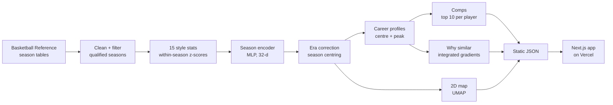
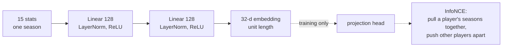
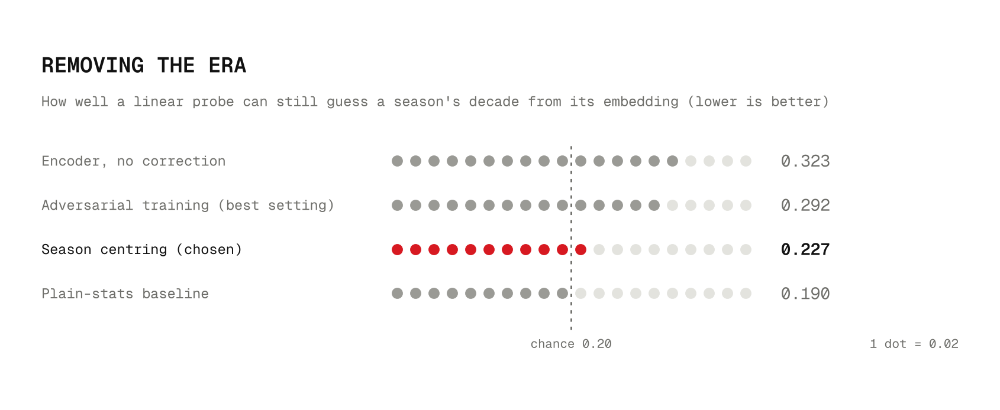
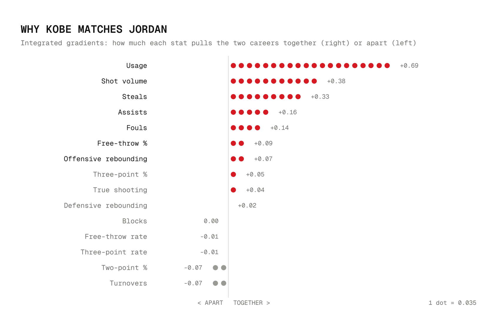
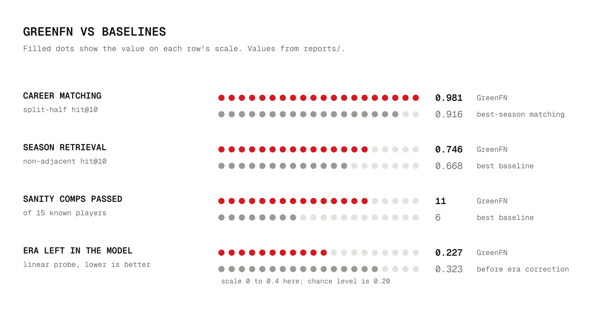

# GreenFN

**Find the NBA careers that played most like your favourite player's.**

**Live app: [greenfn-seven.vercel.app](https://greenfn-seven.vercel.app)**

<picture>
  <source media="(prefers-color-scheme: dark)" srcset="docs/images/greenfn-dark.png">
  
</picture>

GreenFN is a machine-learning model that finds NBA players whose careers look alike, based on the style of every season they played since 1980. Type in anyone, or pick your team, and it shows the 10 closest career comps, why they match stat by stat, and every season ever played on one map.

## What you can do in the app

| Feature | What it does |
|---|---|
| **Map** | All 14,672 qualified seasons (1980 to 2026) as dots. Close dots played in a similar style. Colour by decade, position or style region. Drag to move, scroll or pinch to zoom; the 0 to 100 grid gets finer as you zoom |
| **Search, team or legends** | Type any player, pick a team to light up its seasons, or start from 10 hand-picked legends |
| **Career comps** | The 10 most similar careers, each tagged with its style region |
| **Why they match** | For the top 5 comps: all 15 stats as dot rows, showing which pull the two careers together and which pull them apart |
| **Career shape slider** | Re-ranks the comps live to also favour careers with similar consistency |
| **Career playback** | Plays a career season by season on the map, with points, rebounds and assists per game and an up / down / same marker against the previous season |
| **Light and dark** | Nothing OS inspired design in both themes |

## How I built it

I built it in phases, and every phase had a written plan with its pass/fail rules fixed **before** anything ran (`notes/phase*_plan.md`). Results that failed a rule were kept and reported, not tuned away.

### 1. Data

- **Source:** the Basketball Reference season tables from the Kaggle dataset `sumitrodatta/nba-aba-baa-stats`, NBA only, 1980 to 2026.
- **Qualified seasons:** a minutes threshold so tiny samples don't create fake styles. That leaves 14,672 seasons from 2,467 players.
- **Style, not volume:** 15 rate stats that describe *how* someone plays: shot volume, three-point rate, free-throw rate, true shooting, three-point %, two-point %, free-throw %, usage, assists, turnovers, offensive and defensive rebounding, steals, blocks and fouls.
- **Small samples:** shooting percentages are shrunk towards the league average (priors of 50 three-point attempts, 200 two-point attempts and 25 free throws), so a 4-for-5 shooter doesn't look like a sniper.
- **Era-fair scaling:** every stat becomes a z-score within its own season, so "a lot of threes" means a lot *for that year*.
- **Honest splits:** players, not seasons, are split 70 / 15 / 15 into train, validation and test (balanced by debut decade, seed 2026), so the model is never tested on a player it has already seen. Five well-known players are held out entirely for the final evaluation.

### 2. Baselines

Before any neural network, simple distance-based comps on the 15 z-scores set the bar every later model had to beat (`src/baselines.py`, `reports/phase2_baselines.md`).

### 3. The season encoder

- **Pretraining:** masked-feature reconstruction. Hide 25% of a season's stats and learn to fill them in, which teaches the network how stats relate.
- **Contrastive training (InfoNCE):** each batch holds 256 players with 2 seasons each, preferably at least two years apart, plus 15% noise. The network learns to place a player's seasons close together and other players' seasons further away.
- **Search:** embedding size, temperature and pretraining on or off were searched across seeds; validation picked 32 dimensions, temperature 0.05, with pretraining (`reports/phase3_encoder.md`).

### 4. Removing the era

A raw embedding still "knows" the decade a season came from, so comps would lean towards players from the same decade. I tried two fixes:

- **Adversarial training** (a gradient-reversal head trying to guess the era) **failed**: the encoder fooled its own adversary, but a fresh probe still found the era.
- **Season centring** worked: subtract half of each season's average embedding, then renormalise. It cost almost nothing in retrieval (0.745 vs 0.746).

<picture>
  <source media="(prefers-color-scheme: dark)" srcset="docs/images/era-dark.png">
  
</picture>

### 5. From seasons to careers

Each career becomes a profile with three parts:

| Part | What it is |
|---|---|
| Centre | The minutes-weighted average of all the player's season embeddings: how he usually played |
| Peak | The average of his 3 best seasons by box plus-minus: how he played at his best |
| Spread | How far his seasons wander from his centre: how consistent he was |

The career score is `0.25 x centre similarity + 0.75 x peak similarity - lambda x spread difference`, with every term scaled by its spread across training pairs so no term swamps the others. Lambda is 0 by default and is the app's "career shape" slider.

### 6. Explaining every match

"Why similar" uses **integrated gradients** through the whole pipeline (encoder, era correction, profile and score). It walks each player from a league-average season to his real seasons in 64 steps and credits each stat with its share of the score.

<picture>
  <source media="(prefers-color-scheme: dark)" srcset="docs/images/why-dark.png">
  
</picture>

Two checks make sure the explanations are faithful, not just plausible:

- **Completeness:** the credits add up to the score they explain, within 0.106% on average.
- **Deletion test:** resetting the 3 most-credited stats to league average drops the score far more than resetting 3 random stats (0.754 vs 0.224), in 300 of 300 tested pairs.

### 7. The map

UMAP squeezes the 32-dimension embeddings down to 2D (15 neighbours, cosine distance, seed 2026). Its trustworthiness is 0.928, meaning 2D neighbourhoods are mostly real neighbourhoods. The map is a picture for intuition only: comps are always computed in the full model.

### 8. The app

- Everything is **precomputed** (`src/precompute.py`, `src/export_web.py`), so the site is static JSON plus a Next.js front end. No Python server.
- The career-shape slider re-scores comps in the browser. A **parity test** checks the TypeScript scoring against the Python results: the top comp matches for 100% of players and the top-10 set for 99.88%.
- **Design:** Nothing OS inspired, with Doto and Geist Mono type, black, white and one red, data drawn as dots, light and dark themes, and Motion for the micro-interactions. It scores 100 for accessibility in Lighthouse.
- **Tests:** Vitest unit tests plus Playwright browser checks for pan, zoom, playback, grid labels and fixed container sizes.

## Results

<picture>
  <source media="(prefers-color-scheme: dark)" srcset="docs/images/results-dark.png">
  
</picture>

All figures are from `reports/`. Validation numbers chose the settings, so they're optimistic; the held-back test split hasn't been used yet.

| Check | Result |
|---|---|
| Career matching (split each career in half; is the other half in the top 10?) | **0.981** for career profiles vs 0.916 for best-season matching |
| Season retrieval (other seasons of the same player in the top 10, ignoring neighbouring years) | **0.746** for the encoder vs 0.668 for the best baseline |
| Next-season prediction (RMSE, lower is better) | 0.620 for the encoder vs 0.608 for the best baseline and 0.610 for "same as last season". **The encoder doesn't win here**, so it's recorded as a finding |
| Era left in the embedding (linear probe, chance 0.20) | **0.227** after season centring, down from 0.323 |
| Human sanity check on 15 known players (pass / partial / fail) | **11 / 4 / 0** for career comps vs 6 / 8 / 1 for the best baseline |
| Explanation quality | Completeness error 0.106% on average; top 3 credited stats beat 3 random ones in 300 of 300 pairs |
| Map quality (trustworthiness, 1.0 = perfect) | 0.928 |

## Limits

- Nash and Chris Paul is the one known pair no method finds.
- Era is removed for a linear reader, not entirely: a non-linear probe still finds some of it.
- Data starts in 1980, so careers like Kareem's are only partly covered.
- One model seed is shipped.
- Sanity marks are human judgements (mine, plus researched consensus).
- Style region names are a reading aid computed from the map, not a model output.
- Re-running `precompute.py` on the same machine gives identical files, but results can differ slightly between machines (scores shift in the second decimal).

## Data and licence

Statistics come from [Basketball Reference](https://www.basketball-reference.com) via the Kaggle dataset [`sumitrodatta/nba-aba-baa-stats`](https://www.kaggle.com/datasets/sumitrodatta/nba-aba-baa-stats), which is published under **CC0 (public domain)**. The app publishes the model's outputs (comps, scores, breakdowns, map points) plus points, rebounds and assists per game for career playback. Team names appear as text codes only; no team logos are used.

## Tech

| Part | Stack |
|---|---|
| Model and pipeline | Python 3.12, pandas, NumPy, scikit-learn, PyTorch, UMAP, uv |
| App | Next.js 16, React 19, TypeScript, Tailwind CSS, Motion, Canvas |
| Tests | Vitest (including the parity test) and Playwright |
| Hosting | Vercel |

## Repo layout

| Path | Contents |
|---|---|
| `src/` | Data pipeline, models, evaluation, precompute and web export |
| `reports/` | Results for each phase |
| `notes/` | Plans, runbooks, run logs, data card and design references |
| `notebooks/` | Exploration and per-phase notebooks |
| `web/` | The Next.js app |
| `docs/images/` | README screenshots and charts |
