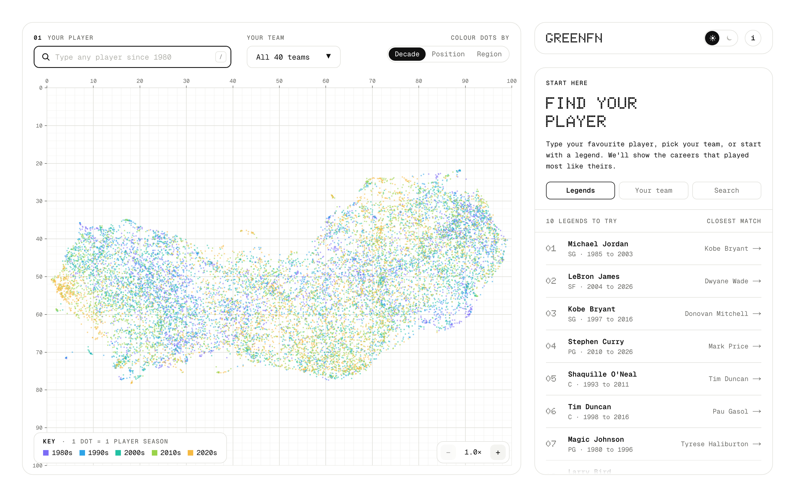

# GreenFN

**Find the NBA careers that played most like your favourite player's.**

**Live app: [greenfn-seven.vercel.app](https://greenfn-seven.vercel.app)**

<picture>
  <source media="(prefers-color-scheme: dark)" srcset="docs/images/greenfn-dark.png">
  
</picture>

GreenFN is a machine-learning model that finds NBA players whose careers look alike, based on the style of every season they played since 1980. A neural encoder turns each season's 15 style stats into a point, an era correction removes the "which decade was this" signal, and each career becomes a profile built from all its seasons. Comps are the closest profiles. Every comp comes with a breakdown of which stats make the two careers alike.

## What you can do in the app

| Feature | What it does |
|---|---|
| **Map** | All 14,672 qualified seasons (1980 to 2026) as dots. Close dots played in a similar style. Colour by decade, position or style region. Drag to move, scroll or pinch to zoom; the 0 to 100 grid gets finer as you zoom |
| **Search, team or legends** | Type any player, pick a team to light up its seasons, or start from 10 hand-picked legends |
| **Career comps** | The 10 most similar careers, each tagged with its style region |
| **Why they match** | For the top 5 comps: all 15 stats as dot rows, showing which pull the two careers together and which pull them apart |
| **Career shape slider** | Re-ranks the comps live to also favour careers with similar consistency |
| **Career playback** | Plays a career season by season on the map, with points, rebounds and assists per game and an up / down / same marker against the previous season |
| **Light and dark** | Nothing OS inspired design in both themes |

## How it works

| Step | What happens | Where |
|---|---|---|
| 1. Data | Basketball Reference season tables, filtered to qualified NBA seasons from 1980; shooting percentages shrunk towards the league average for small samples; every stat turned into a within-season z-score | `src/build_dataset.py`, `notes/data_card.md` |
| 2. Baselines | Simple distance-based comps on the 15 style z-scores, to set the bar every later model must beat | `src/baselines.py`, `reports/phase2_baselines.md` |
| 3. Season encoder | An MLP (15 to 128 to 128 to 32) pretrained with masked-feature reconstruction, then trained contrastively (InfoNCE) so seasons from the same player land close together | `src/encoder.py`, `reports/phase3_encoder.md` |
| 4. Era correction | Each season's embedding has its season's mean subtracted (alpha 0.5). An adversarial era head was tried first and failed; both are reported | `src/era_adversary.py`, `reports/phase4_era.md` |
| 5. Career profiles | Each career = a minutes-weighted centre plus its top-3 peak seasons; the score mixes centre (0.25) and peak (0.75), with an optional consistency term | `src/career.py`, `reports/phase5_career.md` |
| 6. Explanations and map | Integrated gradients through the whole pipeline for "why similar"; UMAP for the 2D map; everything precomputed | `src/explain.py`, `src/precompute.py`, `reports/phase6_explain.md` |
| 7. App | Next.js reads the precomputed JSON. No Python server; the slider's maths runs in TypeScript and is tested against the Python results | `web/`, `src/export_web.py` |

Each phase had a written plan with pass/fail rules fixed before it ran (`notes/phase*_plan.md`).

## Results

All figures are from `reports/`. Validation-set numbers chose the settings, so they're optimistic; the held-back test split hasn't been used yet.

| Check | Result |
|---|---|
| Season retrieval, other seasons of the same player (non-adjacent hit@10, validation) | **0.746** for the encoder vs 0.668 for the best baseline |
| Next-season prediction (RMSE, lower is better) | 0.620 for the encoder vs 0.608 for the best baseline and 0.610 for "same as last season". **The encoder doesn't win here**, so it's recorded as a finding |
| Era left in the embedding (linear probe, chance 0.20) | **0.227** after season centring, down from 0.323 |
| Career matching (split-half hit@10: match a career's first half to its second half) | **0.981** for career profiles vs 0.916 for best-season matching |
| Human sanity check on 15 known players (pass / partial / fail) | **11 / 4 / 0** for career comps vs 6 / 8 / 1 for the best baseline |
| Explanation quality | Attributions add up to the score change within 0.106% on average; the top 3 credited stats matter more than 3 random ones in 300 of 300 tested pairs |
| Map quality (trustworthiness, 1.0 = perfect) | 0.928 |

## Limits

- Nash and Chris Paul is the one known pair no method finds.
- Era is removed for a linear reader, not entirely: a non-linear probe still finds some of it.
- Data starts in 1980, so careers like Kareem's are only partly covered.
- One model seed is shipped.
- Sanity marks are human judgements (mine, plus researched consensus).
- The map is a 2D picture for intuition. Comps are computed in the full 32-dimension model, not from map distance. Style region names are a reading aid computed from the map, not a model output.
- Re-running `precompute.py` on the same machine gives identical files, but results can differ slightly between machines (for example, scores shift in the second decimal).

## Data and licence

Statistics come from [Basketball Reference](https://www.basketball-reference.com) via the Kaggle dataset [`sumitrodatta/nba-aba-baa-stats`](https://www.kaggle.com/datasets/sumitrodatta/nba-aba-baa-stats), which is published under **CC0 (public domain)**. The app publishes the model's outputs (comps, scores, breakdowns, map points) plus points, rebounds and assists per game for career playback. Team names appear as text codes only; no team logos are used.

## Tech

| Part | Stack |
|---|---|
| Model and pipeline | Python 3.12, pandas, NumPy, scikit-learn, PyTorch, UMAP, uv |
| App | Next.js 16, React 19, TypeScript, Tailwind CSS, Motion, Canvas |
| Tests | Vitest (including a parity test against the Python comps) and Playwright |
| Hosting | Vercel |

## Run it yourself

```bash
uv sync                                  # Python 3.12 + pinned deps from uv.lock
uv run kaggle auth login                 # one-time Kaggle login (or set KAGGLE_API_TOKEN)
uv run python src/download_data.py       # -> data/raw/*.csv
uv run python src/build_dataset.py       # -> data/processed/player_seasons.parquet
```

The trained models aren't in the repo (`models/` is git-ignored); train them with the phase scripts in `src/` as described in each phase's runbook. With models in place, regenerate the app's data and start it:

```bash
source .venv/bin/activate
python src/precompute.py                 # -> exports/ (git-ignored), about a minute
python src/export_web.py                 # -> web/public/data/ (committed)
cd web && npm install && npm run dev     # http://localhost:3000
```

Other checks: `npm test`, `npm run build` (one static page per player) and `npm start`.

**Deploy on Vercel:** import the repo and set the root directory to `web`.

## Repo layout

| Path | Contents |
|---|---|
| `src/` | Data pipeline, models, evaluation, precompute and web export |
| `reports/` | Results for each phase |
| `notes/` | Plans, runbooks, run logs, data card and design references |
| `notebooks/` | Exploration and per-phase notebooks |
| `web/` | The Next.js app |
| `config/` | Sanity-check marks |
| `design.md`, `nothing-style.md` | Design notes |

## Status

Phases 0 to 7 (data, baselines, encoder, era correction, career profiles, explanations, app and redesign) are done and live. Next: the final evaluation on the held-back test split and the write-up.
